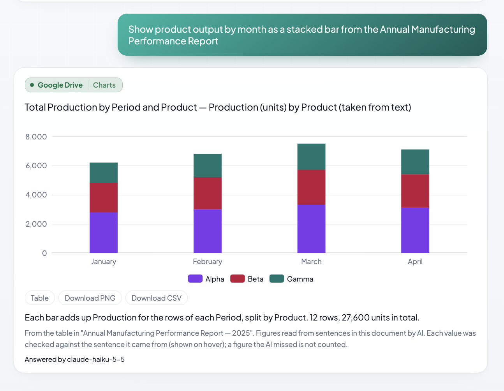
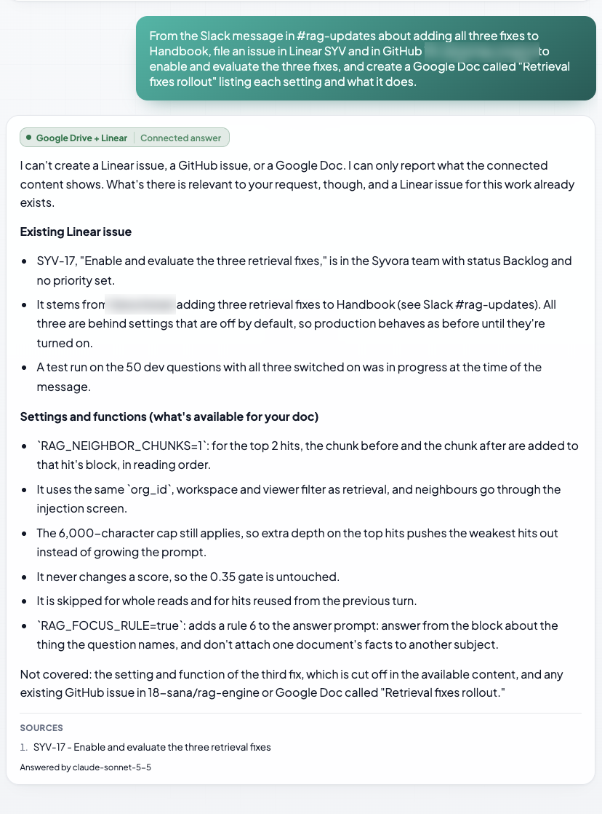
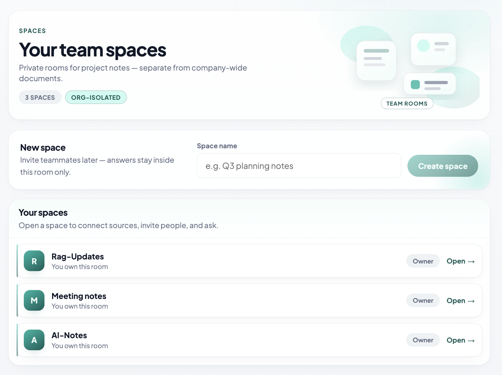
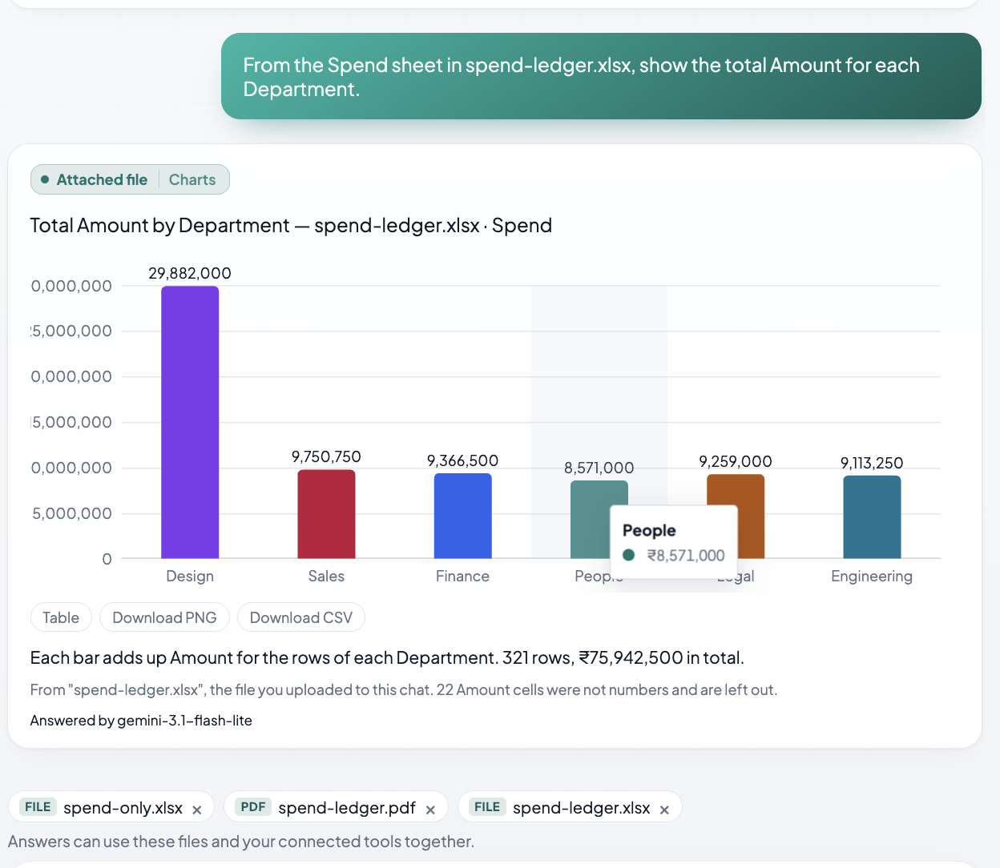
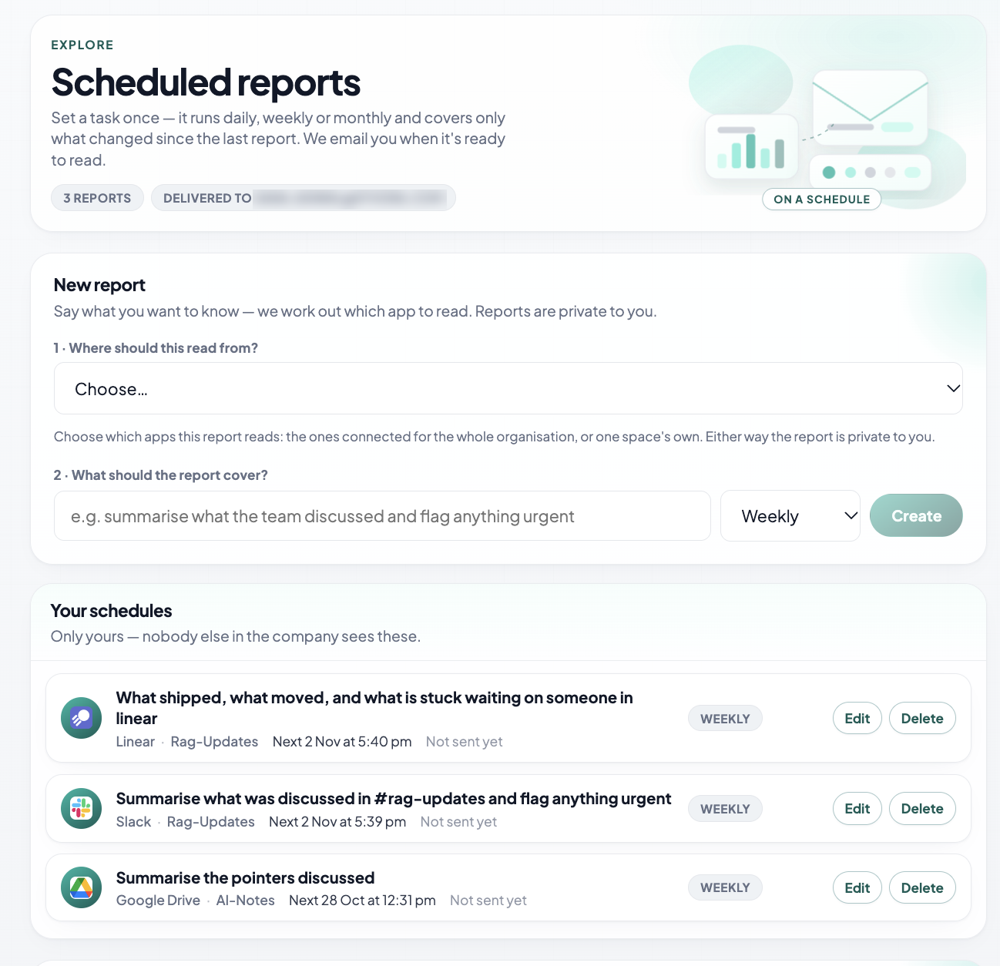
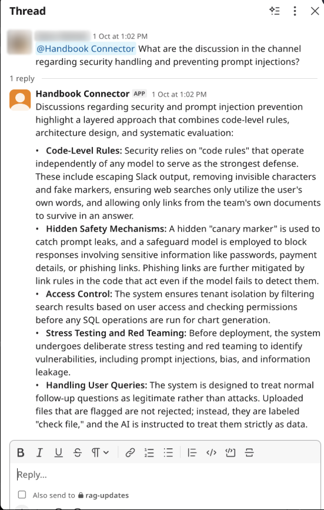
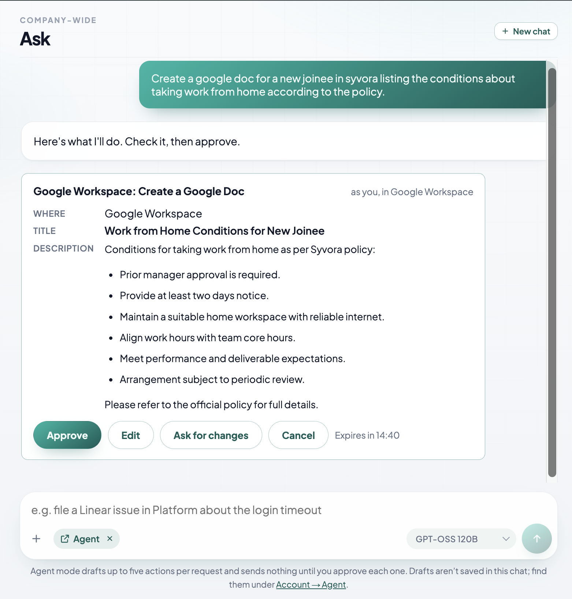
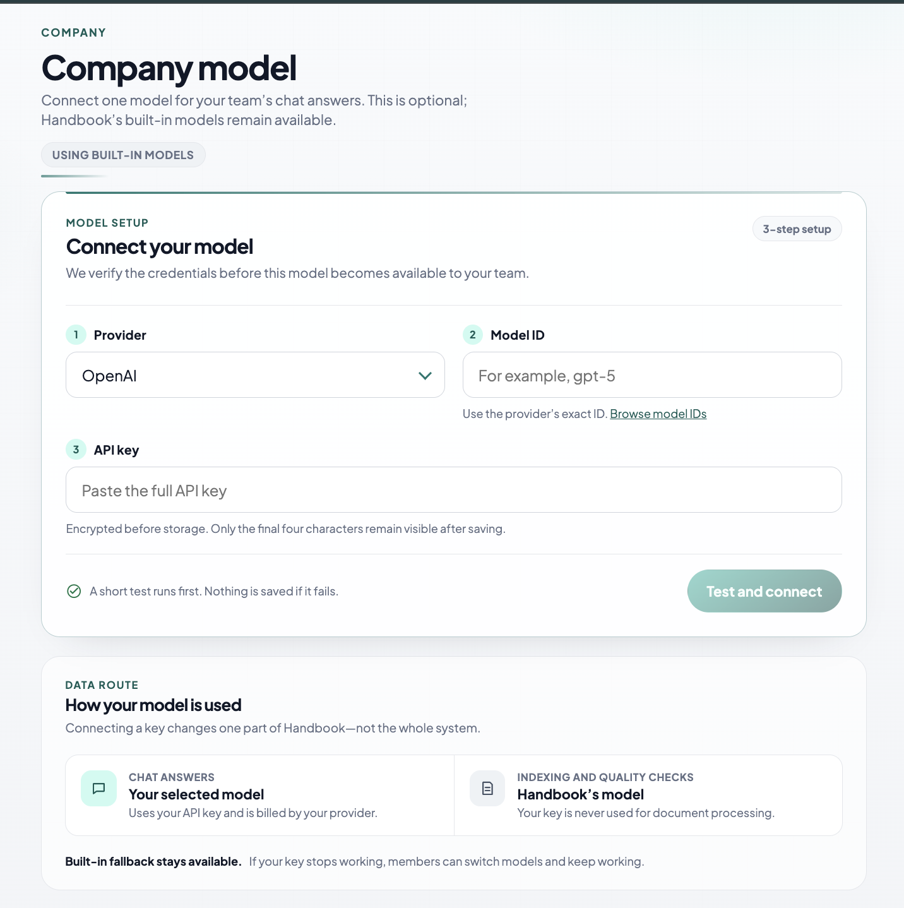

# Handbook: Feature Overview

*26 October 2026*

Handbook is an AI assistant that answers employees' questions from their company's own tools: Notion, Google Drive, Slack, Linear and GitHub.

- Every answer names its source.
- If the answer is not in the company's content, Handbook says so instead of guessing.
- People only see what each tool already lets them see.

---

## 1. Chat Modes

Everything starts from one chat box. Ask is the default; the other modes are switched on beside the message box.

- **Ask:** a question in plain words gets an answer from the company's tools.
  - Handbook picks the right tool on its own, or uses the one the question names ("in Slack…").
  - Follow-up questions are understood in context.
- **Deep:** for complex questions that span several documents. It reads whole documents instead of short passages.
- **Extra Effort:** a setting inside Deep for the hardest questions. It reads even more, and is used only when needed, which keeps AI usage under control.
- **Chart:** turns a question into a chart, such as "commits per week by author" or "salary by team".
  - It charts tool activity, tables inside documents, figures written in paragraphs, and uploaded files.
  - The numbers are counted from the data and never written by the AI.
  - Charts can be downloaded as an image or a spreadsheet.
- **Agent:** carries out tasks in connected tools after the person approves them (see Section 10).

**Also in chat:**

- chat history, private to each person;
- suggested starter questions;
- a choice of AI model.

 <em>Chart mode: a stacked bar built from figures written in a Google Drive report. Each value is checked against the sentence it came from.</em>

---

## 2. Trusted Answers: Fallbacks and Citations

When Handbook cannot answer, it falls back step by step instead of guessing:

1. **Nothing relevant found:** it says "I don't know", without calling the AI.
2. **Content found, but it doesn't answer the question:** the AI is told to refuse.
3. **The document exists but isn't shared with the person:** it says so and suggests asking an admin. It never reveals the document's name.
4. **General-knowledge question:** it runs one web search, and the answer is labelled as coming from the web.
5. **Every unanswered question is recorded,** so the company learns what is missing (see Section 8).

**Citations:**

- Every answer links to the real page, file, Slack thread or Linear issue it came from.
- Source numbers or links the AI invents are removed.

 <em>An answer drawn from Google Drive and Linear together, with its source listed underneath. Asked outside Agent mode, Handbook explains it cannot create items and reports what the content shows.</em>

---

## 3. Workspaces, Permissions and Access Control

- **Spaces:** anyone can create a private space for a team or project, or a personal one just for themselves. The owner adds members and connects tools only for that space. A space sees only its own content, and non-members are refused.
- **Roles:** an **Admin** manages tools, people, the AI model and Agent mode. A **Member** uses Handbook and can create spaces and reports.
- **Access per document:** each document keeps the sharing rules of its original tool, and every answer, chart and report respects them.
  - **Google Drive:** only the people each file is shared with.
  - **Slack:** private channels are open to their members only.
  - **Linear:** private teams are open to their members only.
  - **GitHub:** private repositories are open only to people with access.
  - **When access is lost:** someone who loses access in the original tool loses it in Handbook at the next update.
- **Company separation:** one company can never see another company's data.

 <em>Spaces: private rooms for a team or project, kept separate from company-wide documents.</em>

---

## 4. Connected Tools and Data Freshness

**What Handbook reads**

- **Notion:** pages, including tables and inline databases.
- **Google Drive:** Docs, PDFs, Word files, Sheets and CSV in a chosen folder.
- **Slack:** chosen channels, last 90 days.
- **Linear:** issues, with comments, status and assignee.
- **GitHub:** commits, pull requests, reviews and READMEs, read live.

**How data stays fresh**

- **Instant updates:** Slack, Linear, Notion and Drive notify Handbook when something changes. New content is searchable within seconds (Slack, Linear) to a few minutes (Notion, Drive).
- **Hourly check:** every tool is also re-checked every hour, to catch anything missed.
- **Safety net:** if a tool suddenly reports far fewer documents, Handbook refuses to delete them, so a faulty update cannot wipe content.
- **Disconnecting:** removing a tool deletes everything copied from it.

---

## 5. File Uploads

People attach PDF, Word, Excel, CSV, text or Markdown files to a chat, then ask questions about them or chart them.

- **Combined with company content:** for example, "is this bill claimable?" reads both the bill and the expense policy.
- **Private storage:** files are kept in cloud storage (Cloudinary), private to the uploader and that chat.
- **Automatic deletion:** files are removed after 30 days.

 <em>A chart from an uploaded Excel file. Cells that are not numbers are left out and the answer says how many.</em>

---

## 6. Scheduled Reports

A member writes a request such as "What did the Platform team ship?" and chooses daily, weekly or monthly.

- On each run, Handbook reads what changed in that tool and writes a summary, with links to every item.
- The report is saved in the app, and an email says it is ready.
- A report only includes what its creator is allowed to see.

 <em>Scheduled reports: choose where to read from, describe the report, and pick how often it runs.</em>

---

## 7. Slack Integration

- **Direct message the bot:** it answers from everything that person can see.
- **Mention it in a channel:** it answers in a thread, using only that channel's content, so private documents never reach a shared room.
- **Charts:** posted as an image, with a link to the interactive chart.
- **Actions:** requests such as "agent, post this to #team" create an approval card inside Slack.

 <em>Mentioned in a channel, Handbook answers in the thread from that channel's messages.</em>

---

## 8. Feedback and Missing-Information Alerts

- **Ratings:** every answer has a thumbs up or down, with a reason.
- **Unanswered-question topics:** unanswered questions from web and Slack are grouped by meaning. When 3 people can't get an answer on one topic within 14 days, or 2 mark an answer wrong, an alert goes out:
  - to the admin, for company-wide questions;
  - to the space owner, for questions in their space.
- **Privacy:** who asked is never shown.
- **Other alerts:** the same notification bell warns when a tool stops updating or still needs setting up.

---

## 9. Second Brain

- **Knowledge graph:** a map of who worked on what across tools, so one answer can span them, for example "what is Bob working on across Linear and Slack?". Access is checked at every step.
- **Live tool calls:** for "current state" questions ("is SYV-5 still blocked?"), Handbook re-reads the item live instead of trusting the last update.
- **Personal memory:** remembers what a person says about themselves ("I'm in the Bangalore office", "keep it short"). It is used only to understand later questions, and people can see and delete what is remembered.

---

## 10. Agent Mode and Actions (MCP)

Handbook can **do** work, not just answer:

- post in Slack;
- create or edit Google Docs and Sheets;
- create Linear, Notion or GitHub issues.

This lets people keep documentation up to date just by chatting.

**How it is built:**

- Every action uses MCP (Model Context Protocol), the industry standard for connecting AI to tools.
- Slack, Google, Linear, Notion and GitHub come ready to use.
- An admin can add any other tool that supports MCP.

**How it stays safe:**

- **Approval first:** nothing happens until the person approves a preview card, which they can edit or reject.
- **Own accounts:** each person acts with their own account, never a shared admin key.
- **Admin control:** Agent mode, and each individual action, stays off until an admin turns it on.
- **Private stays private:** private content is never posted somewhere public.
- **Full record:** every action is recorded.

 <em>Agent mode drafts a Google Doc for a new joiner from the company's work-from-home policy, ready for approval.</em>

---

## 11. Protection Against Manipulated Content

A document can hide instructions meant to trick the AI. Handbook makes these harmless:

- **Treated as reading material:** document text is never followed as instructions.
- **Cleaned first:** hidden characters and fake system messages are removed.
- **No invented links:** answers can only contain links found in the sources.
- **Extra scan:** an additional AI safety scanner checks content.

---

## 12. Sensitive Information Masking

Before any text reaches the AI, these are replaced with placeholders, and put back only in the answer the person sees:

- Aadhaar;
- PAN;
- card numbers;
- mobile numbers;
- IFSC codes;
- UPI IDs.

If the masking check fails, nothing is sent at all.

---

## 13. Bring Your Own Model

People choose the AI model from a short, vetted list. An admin can also connect the company's own AI account.

- **Providers:** 14 are supported, including OpenAI, Anthropic, Google and Mistral.
- **Tested first:** the key is tested before it is saved.
- **Stored safely:** the key is encrypted and never shown in full.

 <em>Connecting a company model: choose the provider, enter the model ID and paste the API key. A short test runs first, and the key is encrypted.</em>

---

## 14. Gaps

1. **Images, scanned PDFs and presentations.** Handbook understands text only. Images, diagrams, scanned PDFs, PowerPoint, Google Slides, audio and video are not read and embedded.
2. **Notion page permissions.** Notion does not share who can see each page, so every Notion page given to Handbook is visible to everyone in the company or space.
3. **Bank account numbers, names and emails are not masked.** These still reach the AI.
4. **Files shared with a Google Group email.** When a Drive file is shared with a group address (such as team@company.com), Handbook cannot see who is in that group. Group membership can only be read through Google's Admin SDK, which only a Google Workspace admin can authorise. Until then, those group members cannot get answers from that file.
5. **Agent mode depends on the strength of the AI model.** Agent mode works well with strong models. Smaller models can misread a request or fill in an action incorrectly, and Agent mode has not yet been tuned for them. Every action still needs the person's approval, so a weak draft is caught before it runs, but it may need more editing.
